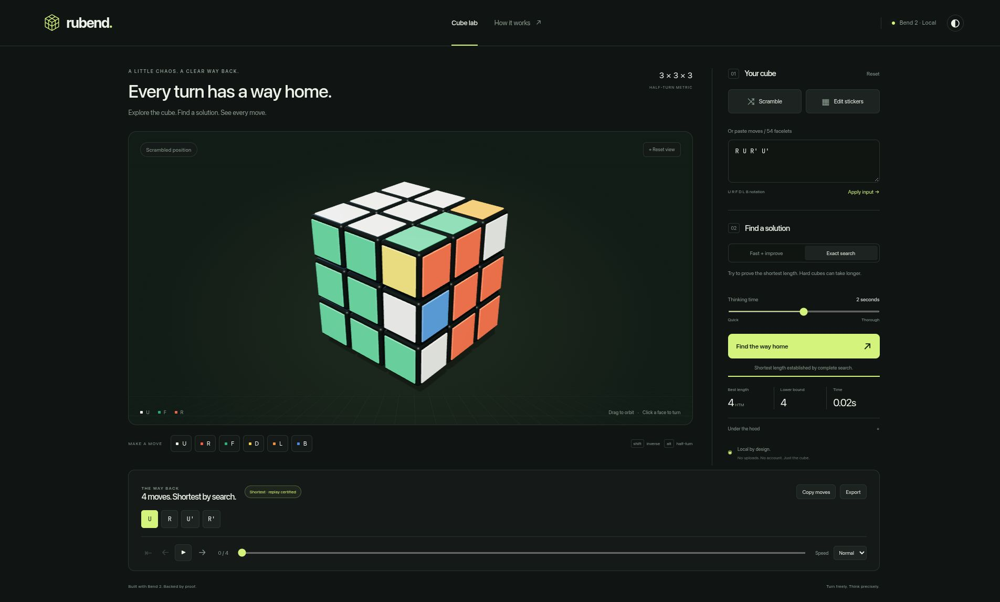

<div align="center">

# Rubend

A 3×3 cube solver, written in Bend 2.

[](https://github.com/bendlang/bend)
[](https://github.com/yuzyayvri/rubend/actions/workflows/ci.yml)
[](flake.nix)
[](LICENSE)

[Run it](#run-it) · [The engine](#the-engine) · [Experiments](#experiments) · [Verification](#verification)

</div>



I'm building Rubend to work on cube search, dependent types, and memory layout
in Bend. The cube rules, search, pruning-table generators, and replay checks
are implemented here. No third-party solver behind the interface.

The workbench connects a native engine to a Three.js renderer through a local
Node service. Paste a scramble, edit stickers, or turn faces directly. Then
solve, scrub through the moves, and export the result. There's a 2D sticker net
if WebGL isn't available.

## Run it

With [Nix](https://nixos.org/download/) installed:

```sh
nix run .
```

Open the loopback URL printed in the terminal. No browser opens automatically.
Solving runs on your machine.

The package currently targets **x86-64 Linux**. The flake pins the toolchain,
including Bend 2.0.37 and the matching Lean dependency for BendTT. Expect the
first build to download a fair amount. The default app generates small pruning
tables; large experimental caches are opt-in.

For development:

```sh
nix develop
npm ci --ignore-scripts
just dev
```

## The engine

Rubend uses two-phase search across three axis frames and their inverse
positions, deduplicating identical roots. A single owned table moves between
tasks instead of being cloned for each search. The native worker retains its
tables across cooperative cancellation.

**Fast** looks for an answer, then improves it. **Exact** also searches full-cube
depth contours to raise a lower bound. Both keep the best verified answer when
the time budget expires. Moves use HTM: a half-turn costs one, just like a
quarter-turn.

Every emitted answer passes Bend's replay-certificate check and another replay
through Bend-generated JavaScript. An answer is marked optimal only when its
established lower bound meets its length. A valid solution and a shortest
solution aren't the same thing.

## Experiments

Most of the work is in the pruning bounds and what they cost to read.

- [Inverse bounds](docs/verification/R02-INVERSE.md) reuse the joint table rather
  than allocate another one. The three-axis pilot cut CPU time by 37.8% on the
  sixteen-position development set at its fixed lower-bound target. That's a
  contour result, not an across-the-board solve-time claim.
- [Packed small tables](docs/verification/R03-SMALL.md) reduced native RSS from
  43,948 to 15,276 KiB in five paired runs, excluding Node and the browser.
  Initialization got slower. It's an optional memory tier.
- [The H0 table](docs/verification/R04-H0-TABLE.md) has 117,567,450 entries,
  each matched against a separately implemented BFS.

Some smaller representations and scheduling changes passed correctness checks
but lost search progress within the same deadline. Those experiments stay in
the repo too. Fewer allocations don't automatically mean a better solver.

The [performance overview](docs/verification/ROADMAP-REPORT-2026-10-19.md)
collects the results and rejected approaches. Hard optimal solves are still
unfinished work.

## Verification

Inside `nix develop`:

```sh
just test
just check
just proof
```

`just test` builds the app and runs model, table, solver, worker, HTTP, and
playback regressions. Independent checks use cubing.js and a breadth-first
oracle through depth four. `just check` runs sixteen toolchain and proof checks;
`just proof` runs the full proof entrypoint through BendTT.

Twenty-three laws cover moves, replay certificates, symmetries, and pruning
identities. Full search completeness and optimality aren't formally certified.
The [proof coverage](docs/architecture/PROOF-COVERAGE.md) spells out the boundary.

[GitHub Actions](docs/verification/CI.md) runs the suite and Nix package checks.
Successful main builds include a downloadable Linux Nix closure with checksums.

[Current work](docs/CURRENT.md) · [Research notes](docs/research/FINDINGS.md) · [Optional profiles](docs/benchmarks/ADVANCED-PROFILES.md)

---

GPL-3.0-or-later. Copyright © 2026 Yuzy.
[License](LICENSE) · [Third-party notices](THIRD_PARTY_NOTICES.md)
